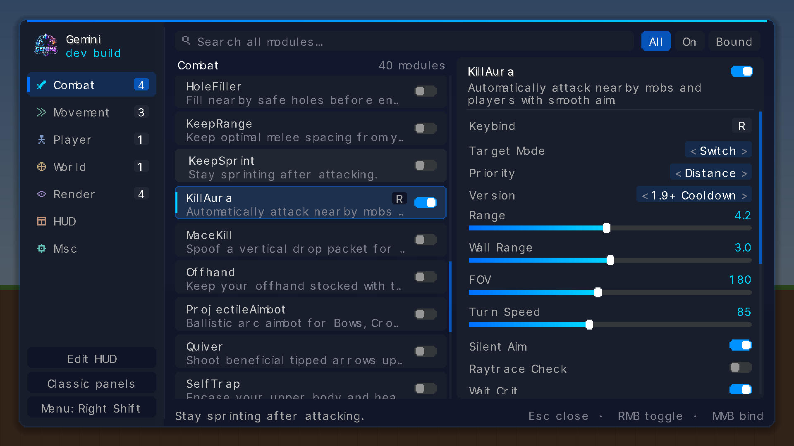

<div align="center">
  

  # Gemini Client

  **A single-player utility / sandbox client for Minecraft 26.3 (Fabric).**

  239 modules · window or panel ClickGUI · draggable HUD · pathfinding bot (Baritone built in)

  [](https://www.minecraft.net/)
  [](https://fabricmc.net/)
  [](https://github.com/mooreconnell24-gif/gemini-client/releases)
  [](https://adoptium.net/)
  [](LICENSE)

  [Install](#installation) · [Controls](#controls) · [Commands](#commands) · [What's new](#whats-new-in-330) · [Build](#building-from-source) · [Issues](https://github.com/mooreconnell24-gif/gemini-client/issues)
</div>

---

## Overview

Gemini is a client-side Fabric mod for playing around in your own single-player worlds: flight, X-ray, ESP, auto-farming, building helpers, game-rule switches, a pathfinding bot and a fully draggable HUD.

**Gemini is single-player only.** Its modules, HUD, commands and bot run in your own private worlds and nowhere else; they pause whenever a world is opened to LAN, and they never run while you are connected to a server.

That is controlled by one switch, **sandbox mode** (on by default):

| Sandbox mode | Gemini | Servers and Realms |
|---|---|---|
| **On** | Active in single-player worlds | Refused, with a screen that says why and offers to switch Gemini off |
| **Off** | Switched off completely: no modules, HUD, commands or bot | Allowed, like an unmodded client |

Flip it with the switch in the top-right corner of the home screen, with `.sandbox on` / `.sandbox off`, or from the screen shown when a connection is refused. There is no setting that runs modules on a server.

Everything runs locally. There is no account system, API key, cloud service or telemetry.

> **Note:** This project was generated by AI as a capability test of modern development workflows. It is a proof of concept for end-to-end AI-assisted building (codebase, build system, GUI and mod logic).

<div align="center">
  
  <br><sub>Window layout (rendered offline; in game the text uses the Minecraft font)</sub>
</div>

## What's new in 3.3.0

**The rework**

- A smooth font in every menu and HUD widget.
- Ten colour themes for the menus and the HUD.
- 239 modules, one per job, with plain names.
- A new home screen, a pause-menu bar, and reworked module menus, HUD, guide and tool screens.
- Configs from 3.2.0 and from earlier 3.3.0 builds are upgraded when they are loaded.

**Look**

- **Font.** Gemini's menus, HUD and notifications are drawn in Inter, a clean sans-serif, in five sizes and three weights. ClickGUI > **Font** switches back to the Minecraft font; layouts are the same in both.
- **Themes.** Gemini, Aurora, Ocean, Mint, Ember, Sunset, Rose, Violet, Mono and Midnight. Each is a pair of accent colours on its own dark surface, and it colours the menus, the home screen, the ArrayList, the Target HUD and notifications at once. Pick one from the swatches on the home screen or in ClickGUI > **Theme**; **Custom** uses your own colours. Old theme names from earlier configs are mapped to the nearest new one.
- **Motion.** Hover, press, opening and closing, switches and value changes are eased. ClickGUI > **Animations** switches all of it off.
- Menus over the game blur and dim what is behind them (ClickGUI > **Blur**).

**Menus and screens**

- **Home screen.** The dark backdrop with the drifting network of points stays, now tinted by the theme. On it: the name in the large font, then Singleplayer, **Continue** (opens the world you played last), Multiplayer, Realms, Options and Quit, and four tiles for Modules, Mods, Guide and Search. A card in the corner lists the first points of this changelog and opens the guide. The footer has the version and the theme swatches; "Vanilla menu" and the sandbox switch are in the top-right corner.
- **Pause menu.** One bar along the top edge with Modules, Edit HUD, Mods, Guide and Panic. It does not move or replace any Minecraft button. A "key conflicts" entry appears only while two actions share a key.
- **Module menu.** Two layouts, chosen in ClickGUI > **Layout**. **Window** has a sidebar of categories, module cards and the settings of the selected module in place, plus pages for presets, key binds, Baritone and mods. **Panels** has one column per category with module rows that expand in place. Both have rounded cards, soft shadows and eased animation.
- **Guide, World backups, Notes and the Keybind report** share one window style: a rounded window with a title, text tabs and a thin scrollbar.
- **Quick search** (`Ctrl+K`, or `K` in game; rebind it in Controls). Finds modules, settings, commands and pages, including by their old names. **Enter** toggles a module, **Shift+Enter** opens it in the module menu, **Tab** switches between result kinds.
- **Setting controls.** Colour picker with a saturation/brightness square, hue and opacity sliders, hex input, copy and paste, and Static/Rainbow/Pulse. Hold Shift on a slider for fine steps, double-click it to type a value. Lists have icons, search and category filters. Modules with many settings show the main ones first and the rest under **More settings**.
- **HUD editor.** Widgets snap to the screen centre, to other widgets' edges and centres, and to equal gaps. Arrow keys nudge the selected widget by 1 px (Shift: 10 px).
- **Notices** shown while a screen is open (a finished backup, the keybind report, the sandbox switch) use Gemini's own card instead of the Minecraft toast.

**HUD**

- **ArrayList** sits on the right edge, sorted by width, with a coloured edge bar; entries slide in and out. It is a widget you can move like the others.
- **Watermark** is one compact line with the name and FPS. Ping is shown only on a real connection.
- **Target HUD** is a card with the target's head, name and an animated health bar.
- **Notifications** stack in the bottom-right corner with an icon and a bar that shows the time left. HUD > **Toast Position** moves them and HUD > **Toasts** switches them off.
- Potion timers, armour and the other widgets use the same cards and follow the theme. Widgets placed automatically never overlap: when they do not all fit, they shrink a step.
- New widgets: Day Info, Spawn Info, Session Stats, Weather Forecast, Mob Caps, Ender Chest Preview and Pinned Notes.

**Modules**

- The list went from 316 modules to 239. Modules that did nearly the same thing are now one module with a mode or a setting, and names are plain Title Case ("Kill Aura", "Trigger Bot", "Auto Totem"). Searching for an old name, or using it as a command, still finds the module.
- Merged, for example: Offhand into Auto Totem; AutoGapple, SmartEat and AutoSoup into Auto Eat; AutoClicker into Trigger Bot; Glide into Flight; Strafe into Speed; Eagle into Safe Walk; InstantMine and PacketMine into Fast Break; Fast Use into Fast Place; Time, Weather, Gamemode, Seed and World Rules into World Tools; AntiBlind, NoBob and NoHurtCam into No Render; Tower into Scaffold. The README has the full table.
- Removed: modules that only made sense against other players or a remote server, and ones that duplicated a vanilla command.
- **Ambience** (new) changes the time of day and the weather you see without changing the world.
- **Zoom** scrolls to zoom and slows the mouse with the zoom level. **Jesus** defaults to Solid. **Surround** closes the whole box around you.

**Aim and targeting**

- Every module that picks a target (Kill Aura, Aim Assist, Trigger Bot, Bow Aimbot, Silly Aimbot, Auto Crystal, Anchor Aura, Bed Aura, Auto Trap, Web Aura, Hole Filler, Auto City, Hole Push, Hit Crystal, Shield Breaker, Keep Range, Target Strafe, Auto Block, Flamethrower and Follow Bot) has the same settings: **Priority** (Closest, Lowest Health, Highest Health, Closest To Crosshair, Most Armor, Least Armor, Most Dangerous), **Prefer** (Any, Players First, Mobs First), **Stick To Target**, and filters for players, hostiles, passives and invisible mobs.
- **Target Box** draws an outline, a fill or both around the current target, in a fixed colour or coloured by health, optionally through walls.
- **Bow Aimbot** (was ProjectileAimbot; your settings carry over). Aims bows, crossbows and tridents using the game's drag and gravity, leads moving targets and accounts for your own movement. Settings: Low, High or Auto arc; **Aim Point** (Head, Chest, Feet or Auto); **Wall Check**; a drawn trajectory with an impact marker; **Auto Release** and **Auto Charge**.
- **Silly Aimbot** (new). Your arrows and tridents, and optionally snowballs, eggs and ender pearls, steer toward the target and around blocks and mobs in the way. Speed, turn rate, look-ahead, maximum time and retargeting are adjustable, and the path is drawn. It only works in your own single-player world, because it moves the projectiles on the integrated server.

**World tools**

- **World Backup** saves a zip copy of the open world in the background, on a timer or when you ask, and keeps the newest few. The **World backups** screen lists them and restores one as a new world; the original is never overwritten.
- **World Notes** (`N`) opens a notes pad saved inside the world. Lines starting with `[ ]` are to-dos, and the **Pinned Notes** widget shows them on the HUD.
- **Measure** gives the distance, size and block count between two blocks you middle-click.
- **Mods.** A page of the module menu, also on the home screen and the pause bar, that searches Modrinth for mods and resource packs for your game version. Mods are downloaded with the mods they need and load the next time you start Minecraft; resource packs can be switched on straight away. It also lists what is installed, checks for updates, and can switch a mod off or remove it.

**Find and share**

- **Share codes.** "Copy share code" in Presets, or `.config share <name>`, copies your settings as one line starting with `gemini:`. "Paste share code", or `.config import code`, lists what would change before you save or apply it.
- **Key-bind warnings.** Binding a key that a module or a vanilla control already uses shows a warning. The first time you enter a world each session, one notification lists any existing conflicts.
- **This guide.** What's new, the controls of both menu layouts, every command, and an About page. It opens by itself once after an update; afterwards from the home screen, the pause bar, the module menu, `.help` and `.changelog`.

**Config upgrade**

- Settings and key binds of renamed and merged modules move to the module that replaced them. A backup of the config file is kept next to it.
- Renamed settings and mode values (for example the Kill Aura priorities and the theme names) are mapped to their new names.
- Colours have saturation, brightness, opacity and a Rainbow or Pulse mode. `.<module> <setting> #RRGGBB` sets one by hex code.

**Fixes**

- Switching a bot module off cancelled any Baritone task, even one started by another module. Each module now stops only its own task.
- Timer and Tick Freeze could leave the world fast or frozen after leaving it or opening it to LAN. The tick rate is now always restored.
- Auto Totem kept the offhand reserved at low health with no totem left, blocking other offhand modules.
- Flight could leave survival flight on after a game-mode change; Auto Walk could leave sprint held; Freecam kept the previous dimension's position.
- Module suffixes showed "0,55" on systems that use a decimal comma.
- Mob Caps counted against the wrong cap, and Weather Forecast showed the same time for rain and thunder.
- Placing modules check that your aim hits the block face before placing (**Raycast Check**, on by default) and can turn gradually (**Aim Speed**).
- Modules that changed video settings (Fullbright, Performance, No Render) could save their temporary values to your options file.

**New modules**

| Module | What it does |
|---|---|
| Silly Aimbot | Steers your arrows and tridents around obstacles toward the target |
| Auto City | Mines the surround block of a target in a hole, optionally placing a crystal first |
| Hit Crystal | After a sword hit: places obsidian and a crystal, then detonates it |
| Hole Push | Pushes a target out of its hole with a piston and redstone |
| Auto Regear | Places a shulker box, refills items to set counts, then mines the box |
| Multi Task | Attack or mine while eating or using an item |
| Chams | Shows entities through walls: Flat, Textured (outline), Wireframe or Pulse |
| Break ESP | Progress boxes and percentages on blocks being mined |
| View Model | Moves, scales and rotates the items in your hands |
| Pop Chams | Shows a fading copy of a player where they popped a totem |
| Totem Pop Counter | Counts totem pops per player (chat, notification, Nametags, Target HUD) |
| Auto Build Bot | Builds a nether portal, wither, wall, platform, pillar or bridge from your inventory |
| Ambience | Changes the time of day and weather you see, not the world's |
| Measure | Distance, size and block count between two middle-clicked blocks |
| World Backup | Zips the open world in the background and restores copies as new worlds |
| World Notes | A notes pad saved inside the world; `[ ]` lines are to-dos |
| Pinned Notes | HUD: your open to-dos from World Notes |
| Day Info | HUD: day number, time, moon phase and time until night or morning |
| Spawn Info | HUD: world spawn and your bed or anchor, with distance and direction (Nether-aware) |
| Session Stats | HUD: blocks mined and placed, kills, deaths, damage, crafts and XP this session, optionally per hour |
| Weather Forecast | HUD: time until rain or a thunderstorm starts or stops |
| Mob Caps | HUD: mobs counted against each spawn cap |
| Ender Chest Preview | HUD: your ender chest contents |
| Coords Copier | Copies your position (plain, comma-separated, `/tp` or `/execute`) to the clipboard |
| Screenshot Helper | Hides the HUD, takes one screenshot or a burst, then shows it again |
| Quick Move | Shift and drag across container slots to move every stack you pass over |
| Craft Repeat | Repeats the last recipe-book craft until ingredients or a batch limit run out |
| Biome Border | Draws a fence where the biome changes |
| Harvest ESP | Highlights ripe crops, nether wart, cocoa, berries, melons and pumpkins |

<details>
<summary>What was new in 3.2.0</summary>

**Sandbox mode instead of "remove the jar".** The multiplayer lock is now a switch. With it on, Gemini works as before and a refused connection gets a screen that explains why. With it off, Gemini is completely dormant and you can play online without uninstalling it. Modules still never run on a server.

**Safer saves.** The config is written on a background thread to a temporary file, forced to disk and renamed into place, so a crash or power cut can never leave half a file. The previous version is kept as `gemini_config.json.bak` and is restored automatically if the config cannot be read. A save that fails is retried and reported instead of being lost.

**Shareable profiles.** `.config export <name>` writes your settings to `config/gemini_exports/` (or `.config export <name> clipboard` copies them). Exports leave out waypoints, your home, death coordinates and menu layout. `.config import <name> [clipboard]` stores one as a profile.

**Faster built-in pathfinder.** The fallback A* was rebuilt around reused primitive arrays and a chunk cache: a search no longer allocates per node, reads blocks several times faster, and uses a tighter heuristic. Unloaded chunks are treated as walls and waited for instead of being bridged into, paths are kept while they are still walkable instead of being recomputed every 1.6 seconds, and a pause for combat or an open screen no longer looks like "stuck".

**One bot at a time.** Baritone and the built-in engine can no longer steer you at once: a request to one stops the other.

**Lighter rendering.** ESP boxes behind you are skipped before any work is done, an outlined and filled box is drawn as one shape instead of two, HoleESP and Trajectories do their world queries once a tick instead of once a frame, and a frame has a shape budget so a huge block list cannot freeze the game.

**Fixes you might notice**

- Modules that send packets from their tick could lose their place in the priority order for the rest of that tick, letting a lower-priority module take the hotbar slot or rotation from them.
- Xray could keep showing ore positions from before it was switched off or reconfigured, and from the previous dimension after a portal.
- Combat and render modules kept targets and markers from the previous dimension after going through a portal.
- The ClickGUI **Blur** switch did nothing.
- One damaged entry in a saved Marker list no longer discards the whole list.

**New modules**

| Module | What it does |
|---|---|
| Cleanse | Clears harmful (or all) potion effects with one click or key |
| Free Slots | HUD: empty inventory slots, red when nearly full |
| Food Info | HUD: hunger and the saturation vanilla hides |
| Xp Info | HUD: level, progress to the next level and total points |

**Merged**

| Was | Now |
|---|---|
| ReverseStep | **Fast Fall** › *When*: `Ledges` (its Height and Speed are now *Ledge Height* and *Ledge Speed*; `Both` runs the two together). Your settings, switch and key bind are carried over, and `.reversestep` still finds it |

</details>

<details>
<summary>What was new in 3.1.0</summary>

**New modules**

| Module | What it does |
|---|---|
| Buffs | Permanent potion effects on switches: god mode, speed, haste, night vision and more |
| Enchanter | Maxes out the held item or your armour with the best vanilla enchantments |
| Give List | Gives you your own list of items in one click |
| Platform | Puts a platform under your feet, or removes it |
| Locate | Finds the nearest structure or biome, pins it and optionally teleports there |
| Auto Save | Saves the world every few minutes |
| Performance | FPS mode: low render distance, no clouds, shadows or particles, restored when switched off |
| Cinematic Camera | Smooth camera movement for recording |

**Menu.** Eight more themes, a *Surface* setting for the panel colour (Dark, OLED, Slate, Graphite, Plum), *Category Tint*, and **favourites**: star a module on its card and filter by ★.

**Also.** Death Coords can pin a waypoint and teleport back, World Rules sets the difficulty, Home can set your spawn point, and `.version` reports any Minecraft hook that failed to apply.

</details>

<details>
<summary>What was new in 3.0.0</summary>

**Baritone built in.** The jar bundles a [Baritone](https://github.com/cabaletta/baritone) build for Minecraft 26.3, so every bot module and `#` command (`#goto`, `#mine`, `#follow`, `#tunnel`, `#farm`, `#explore`, `#excavate`) runs on it with no extra download. If Baritone fails to load, Gemini falls back to its built-in pathfinder.

**Built-in pathfinder rebuilt.** The fallback engine now prices mining by what your best hotbar tool needs, adds the cost of sand or gravel, and correctly handles drop jumps and lava.

**Block breaking fixed.** Vanilla aborts a block in progress every tick the attack key is held, so Nuker, VeinMiner, the bed breaker, PacketMine and the bot's own mining could only ever break instant blocks.

**Modules never fight over your hands.** Every module runs at an `ActionPriority` (survival > combat > movement > world utility > bot).

**One file per module, one event bus.** The module containers were split into `gemini/module/modules/<category>/<Module>.java` with no change to config keys.

**Smoother menus.** Searching in either menu is fuzzy and covers names, aliases, descriptions and setting names.

**New modules**

| Module | What it does |
|---|---|
| Auto Heal | `/effect` heal (instant health, regeneration or full heal, plus saturation) when your health drops below a threshold |
| Kits | PvP, Crystal, Builder, Miner, Explorer or Food loadouts with `/give` and `/item`, armour equipped straight away |
| Mob Sweeper | Clears hostile mobs, all mobs or dropped items around you with `/kill` on an interval |
| Summoner | Summons a chosen mob (or lightning) a few blocks in front of you, bindable |
| Aim | Spring smoothing and the silent-aim marker for every rotating module |

Configs from 2.x are upgraded automatically.

</details>

<details>
<summary>What was new in 2.2.0</summary>

**New window menu.** One centred window with a category sidebar, a module list that searches every category, and a settings pane for the selected module.

**New modules**

| Module | What it does |
|---|---|
| World Rules | Switches for Keep Inventory, Daylight/Weather Cycle, Mob Spawning, Mob Griefing, Fire Spread, Phantoms, Fall Damage, Instant Respawn, plus a Random Tick Speed slider |
| Tick Freeze | Freezes mobs, redstone and time while you keep moving; Step advances it |
| Macro 1–3 | Bind a key to a list of `/commands`, `.gemini` commands or chat lines |
| Inventory Sorter | Sorts and merges your inventory by item or stack size |
| Durability Alert | Warns once before armour or a held tool breaks |
| Waypoints (upgraded) | 3D beacons and labels, pins kept per world, `.waypoints add/remove/list/tp/clear` |

**Bug fixes.** These are the ones you would have noticed:

- **AutoFish** reeled the bobber back in right after casting.
- **NoFall** no longer hurts at high speed.
- **Silent aim** works correctly for item use.
- **AutoSoup** works with modern eating times.
- **NoWeb** really lets you walk through webs and similar blocks.
- **Criticals** default modes now work as expected.
- **SmartEat** no longer misbehaves with golden apples.
- **InventoryMove** uses vanilla movement rules.
- Sliders no longer show drifting decimal values.
- The config is no longer rewritten on every slider or HUD drag.

The rest:

- AntiVoid has a Teleport mode.
- Zoom and Free Look binds default to Hold.
- PacketLogger hides per-tick packets.
- Smaller fixes landed in AirJump, AutoGapple, AutoWalk, AutoBlock, KillAura, Nuker, Slime Chunks and Presets.

</details>

## Highlights

| | |
|---|---|
| **239 modules** | Combat, Movement, Player, World, Render, HUD and Misc: one module per job, each with a plain name and a short list of settings |
| **Two menu layouts** | Window (fuzzy-search everything, settings side by side) or classic panels |
| **HUD widgets** | FPS, TPS, armour, potions, radar, TargetHUD, keystrokes, graphs and more; drag them anywhere with magnetic snapping |
| **Pathfinding bot** | Drives the bundled Baritone; built-in 3D A* fallback with `#goto`, `#mine`, `#follow`, `#tunnel`, `#farm`, `#explore`, `#excavate` |
| **Priority arbitration** | Modules claim hands and rotations in priority order, so survival modules always win |
| **Profiles** | Crash-safe autosave with a backup, named profiles, and export/import for sharing |
| **Crash isolation** | A failing module is switched off and reported instead of taking the game down |

## Module overview

| Category | Modules | Examples |
|---|---|---|
| Combat | 32 | Kill Aura, Trigger Bot, Auto Totem, Velocity, Criticals, Auto Crystal, Anchor Aura, Bow Aimbot, Silly Aimbot, Surround, Web Aura |
| Movement | 33 | Flight, Speed, Step, Jesus, No Fall, No Slow, Safe Walk, Spider, Elytra Fly, Boat Fly, Click TP |
| Player | 42 | Clutch, Auto Armor, Auto Eat, Auto Tool, Fast Break, Fast Place, Chest Stealer, Inventory Cleaner, Kits, Buffs, Regen |
| World | 31 | Scaffold, Nuker, Auto Farm, Vein Miner, World Tools, Spawn Proofer, Timer, Tick Freeze, Summoner, Waypoints |
| Render | 45 | ESP, X-Ray, Fullbright, Zoom, Freecam, Free Look, Ambience, No Render, Chams, Storage ESP, Block ESP, Nametags, View Model |
| HUD | 37 | ArrayList, Target HUD, Position, FPS, TPS, Armor, Potion Timers, Radar, Keystrokes, Session Stats, Custom Text |
| Misc | 19 | ClickGUI, Rotations, Presets, Macro 1–3, Panic, Performance, Anti Lag, World Backup, World Notes, Name Protect |

Each job has one module. Where several modules used to do nearly the same thing they are now one, with the old ones as a mode or a setting; every old name still finds its module in the search and in `.name` commands.

| Module | What it took in |
|---|---|
| Auto Totem | Offhand: the **Item** setting keeps a shield, golden apple or crystal in your offhand and swaps a totem in when you are in danger (low health, a lethal fall, gliding) |
| Auto Eat | AutoGapple, SmartEat, AutoSoup: **Golden Apples** eats one at low health |
| Trigger Bot | AutoClicker: **Require Click** and **Weapon Only** |
| Super Knockback | WTap |
| Web Aura | Auto Web Fill: webs the target's feet and its predicted path (**Webs Ahead**) |
| Surround | SelfTrap, BlockIn: **Cover** is Feet, Head or Full |
| Flight | Glide (a mode, with **Fall Speed**) |
| Speed | Strafe (**Air Control**) |
| No Slow | NoWeb, TerrainSpeed: one switch each for items, cobwebs, berry bushes, powder snow, soul sand and honey |
| Safe Walk | Eagle: **Mode** is Stop or Sneak |
| Auto Jump | Auto Hop (**Always**) |
| Parkour, Hole Snap, Spider, Elytra Fly | EdgeJump, Hole Pull, WallClimb, ElytraBoost |
| Fast Break | InstantMine (**Instant** mode), PacketMine (**Keep Mining**), and **No Delay** between blocks |
| Fast Place | Fast Use (**Blocks Only** off) |
| Inventory Cleaner | Auto Drop: drops the items you list, or everything except them |
| Kits | Give List (the **Custom** kit) |
| Buffs | Cleanse (**Clear Bad Effects**, **Auto Cleanse**), Potion Spoof, NoHunger (**Saturation**) |
| Regen | Auto Heal (**Below Health**) |
| Auto EXP | EXP Thrower and the combat Auto EXP |
| World Tools | Time, Weather, Gamemode, Seed and World Rules: one-click buttons plus the game-rule switches |
| Spawn Proofer | Auto Torch |
| Nuker | Bed Breaker: **Filter** breaks only the blocks you list |
| Lawn Mower | Extinguish |
| No Render | AntiBlind, NoBob, NoHurtCam |
| View Model | Animations (**Swing Duration**) |
| Zoom | Cinematic Camera, plus scroll to zoom and a mouse that slows with the zoom |
| Breadcrumbs, Break ESP | PlayerTrails, BreakIndicators |
| Scaffold | Tower, BlockCounter (**Show Count**) |

Removed because they only made sense against other players or a remote server, or duplicated a vanilla command: AutoPearl, AutoRod, Backtrack, BlockHit, Teams, Freeze, Gap Closer, Slippy, Derp, NoRotateSet, AutoWindCharge, BedPlates, Bed Defender, LogoffSpot, PearlTracker, Tunnel ESP, Stash Finder, StrongholdFinder (Locate finds strongholds), Auto Nametag, AutoGG, FlagCheck, Notifier, PacketLogger, Baritone Status, EntityCulling (Anti Lag hides distant name tags), Coordinates (the Position widget), and the HUD widgets Welcome, Totem Counter (Combat Items), Lag Notifier, Chunk Info, Food Info, Xp Info and Free Slots (Custom Text has `{chunk}`, `{food}`, `{saturation}`, `{xp}` and `{slots}`).

New: **Ambience** (Render) changes the time of day and the weather you see without changing the world.

### Clutch

Clutch (Player) watches for whatever is about to kill you and answers it with the best item in your hotbar or offhand.

| Danger | What Clutch does |
|---|---|
| Lethal fall | Predicts the fall damage for the block you will land on and MLGs with a water bucket, cobweb, twisting vines, powder snow, slime, scaffolding or (when survivable) hay. **Brake** slows a very fast fall just enough to fit the MLG into reach, and **Scoop** picks the water back up |
| Lava | Water or a block onto lava you are falling into, water and a swim out if you are in it, and **Lava Guard** stops you walking or stepping off into it |
| Fire | Drops water at your feet once health is low enough to matter |
| Void, drowning, suffocation | Swims up for air; with Last Resort, teleports you back to the last safe spot or gives water breathing |
| Low health | Moves a totem into your offhand |

**Last Resort** (single-player) steps in when no item can help: it resets fall damage just before you land, gives fire resistance, water breathing or healing, or teleports you to the last safe ground. **Danger / Fall / Lava / Health Modules** are lists of other modules Clutch switches on during that danger (Lava defaults to Jesus, Health to AutoTotem); **Restore Modules** turns them back off once you have been safe for **Restore Delay** ticks. Edit them in the menu or with `.set Clutch Lava_Modules add <module>`.

## Installation

### Requirements

| Requirement | Version |
|---|---|
| Minecraft Java Edition | **26.3** |
| Fabric Loader | 0.19.5 or newer |
| Fabric API | Built for 26.3 (developed against `0.165.2+26.3`) |
| Java | 25 or newer |

### Steps

1. Install **Fabric Loader** for Minecraft 26.3.
2. Put the matching **Fabric API** jar into your `mods` folder.
3. Download the `gemini-<version>.jar` in the root of this repo (or build it, see below) and put it in `mods`.
4. Baritone is already bundled inside the jar. Do not add a separate Baritone jar to `mods`.
5. Start the game with the Fabric profile and open a single-player world.
6. Press **Right Shift** to open the menu.

## Controls

**Window layout (default)**

| Input | Action |
|---|---|
| **Right Shift** | Open / close the menu (rebind it from the sidebar or in Controls) |
| **K** (in game) / **Ctrl + K** (in menus) | Quick search: modules, settings, commands and pages |
| **Click a module** | Show its settings |
| **Click the switch** / **right-click** a module | Toggle it |
| **Middle-click a module** | Bind a key (`Delete` clears, `Esc` cancels) |
| **Type anything** | Search every module and setting name; `Esc` clears and keeps your selection |
| **↑ ↓**, **Enter**, **Tab** | Move the selection, toggle it, switch category or page |
| **Right-click a setting** | Reset it to the default |

**Classic panels**

| Input | Action |
|---|---|
| **Left click** | Toggle a module |
| **Right click** | Open module settings |
| **Middle click** | Bind a key (`Delete` clears, `Esc` cancels) |
| **Shift + right click** | Star / unstar a favourite |
| **Type anything** | Search modules and setting names; **↑ ↓** move, **Enter** toggles, **Shift + Enter** opens settings |
| **Shift + drag** | Move HUD widgets (**Alt** drags without snapping) |
| **Arrow keys** | Nudge the selected HUD widget by 1px (**Shift**: 10px) |
| **Double-click a slider** | Type an exact value |
| **Ctrl + F** | Search |

## Commands

Chat commands use a `.` prefix. Module names are case-insensitive.

| Command | Description |
|---|---|
| `.help` | Command list |
| `.gui` | Open the menu |
| `.toggle <module> [on\|off]` or `.<module>` | Toggle a module |
| `.set <module> <setting> <value>` / `.get <module> [setting]` | Change or inspect a setting (`_` for spaces) |
| `.bind <module> <key>` / `.unbind <module>` / `.binds` | Key binds (`.binds` flags keys used twice) |
| `.modules [category]` | List modules |
| `.config save\|load\|delete\|list\|reset <name>` / `.reload` | Profiles and the config file |
| `.config export <name> [clipboard]` / `.config import <name> [clipboard]` | Share a profile as a file in `config/gemini_exports/` or as text |
| `.sandbox [on\|off]` | Sandbox mode: on keeps Gemini active and offline, off switches Gemini off for online play |
| `.waypoints add [name]\|remove <name>\|list\|tp <name>\|clear` | Waypoints in this world |
| `.sethome` / `.home` / `.back` | A saved teleport in this world |
| `.gm <mode>` / `.day` / `.night` / `.sun` / `.rain` / `.heal` / `.feed` | World and player shortcuts |
| `.vclip <blocks>` / `.hclip <blocks>` / `.coords` | Movement and position helpers |
| `.panic` | Turn every module off |
| `.version` | Gemini and Minecraft versions |
| `.selftest` | Crash-test every module in a throwaway world |

Pathfinding commands use `#` (`.b` also works):

| Command | Description |
|---|---|
| `#goto <x> [y] <z>` | Pathfind to coordinates |
| `#mine <block> [block...]` | Find and mine blocks, e.g. `#mine diamond_ore` |
| `#follow [player\|players\|mobs]` | Follow a player or mobs |
| `#tunnel [length]` / `#excavate [radius] [depth]` | Dig a tunnel or clear an area |
| `#farm` / `#explore` | Harvest crops / spiral into new chunks |
| `#sel pos1\|pos2\|clear` / `#thisway <distance>` / `#axis` | Selections and goals |
| `#pause` / `#resume` / `#stop` / `#status` | Control the current task; `#status` names the engine in use |

Any other Baritone command (`#set`, `#build`, `#schematica`, `#find`, ...) is passed straight through to it.

## Configuration

| Path | Contents |
|---|---|
| `config/gemini_config.json` | Modules, settings, key binds, HUD layout, panels and the `sandboxMode` switch |
| `config/gemini_config.json.bak` | The previous good save |
| `config/gemini_profiles/` | Named profiles from `.config save <name>` |
| `config/gemini_stashes.log` | Stashes found by Stash Finder |
| `config/gemini_exports/` | Portable profiles from `.config export <name>`; drop a received file here and run `.config import <name>` |

Changes are saved a moment after you stop editing, and always on exit. Saves are atomic: the file on disk is always a complete one. If the config cannot be read, Gemini restores the backup and tells you; only if that is unreadable too does it start from defaults. Either way the unreadable file is kept as `gemini_config.json.broken`.

## Building from source

Requirements: JDK **25**, Git, and internet access for the first Gradle run.

```bash
git clone https://github.com/mooreconnell24-gif/gemini-client.git
cd gemini-client
./gradlew build
```

On Windows use `gradlew.bat build`. The jar lands in `build/libs/gemini-<version>.jar`. `build` also runs the unit tests (`./gradlew test` runs just those). Run a development client with `./gradlew runClient`.

## Project layout

```text
src/main/java/gemini/
├── Gemini.java              Client entrypoint
├── command/                 Chat command system
├── config/                  Config, atomic JSON files, migrations, profiles and profile bundles
├── diags/                   Report of Minecraft hooks that failed to apply
├── event/                   Priority event bus, @EventHandler, ActionPriority
├── input/                   Key mappings and keybind conflict checks
├── mixin/                   Fabric mixins; mixin/lock refuses server connections while sandbox mode is on
├── module/                  Module framework, settings, categories, shared bases (placement, aura, linear flight)
│   └── modules/<category>/  One file per module
├── render/                  3D rendering helpers
├── ui/                      Menus (window + classic panels), HUD overlay, fuzzy search
├── util/                    Baritone bridge + built-in pathfinder, rotations, hands arbiter, single-player gate
│   └── pathing/             The A* search core and the chunk-cached block view
src/test/java/gemini/        Unit tests for the search, the event bus and config handling
└── xray/                    Xray data and compilation
```

## Troubleshooting

| Problem | Fix |
|---|---|
| Crash on launch | Check Minecraft 26.3, a matching Fabric Loader and Fabric API, and Java 25; see `logs/latest.log` |
| "Gemini sandbox mode is on" when joining a server | Expected: Gemini is single-player only. Choose **Switch Gemini off** on that screen (or `.sandbox off`) to play online; switch it back on from the title screen |
| Nothing works in single-player | Sandbox mode is off, so Gemini is dormant: click the title screen button or type `.sandbox on` |
| Modules will not turn on | Open a single-player world; modules pause while the world is open to LAN |
| Menu will not open | Check Options › Controls › Gemini Client › Open Gemini |
| A module switched itself off | It crashed and was isolated; the chat message and `logs/latest.log` have details |
| Settings reset | Gemini restores `gemini_config.json.bak` by itself when the config is damaged; otherwise `.config load <name>`, or look at `gemini_config.json.broken` |

## Disclaimer

Gemini Client is a client-side mod for single-player worlds. With sandbox mode on it refuses server and Realms connections; with it off it does nothing at all. The authors are not responsible for lost items, worlds or other consequences.

Gemini Client is not affiliated with Mojang, Microsoft, Fabric, LiquidBounce or Baritone.

## Credits

- **Fabric** for the mod loader and API
- **LiquidBounce Nextgen**, **Rise** and **Meteor** for UI and feature inspiration
- **Baritone** for pathfinding, bundled in the release jar
- **Inter** by Rasmus Andersson and the Inter Project Authors, the typeface of the menus and HUD
- Testers and issue reporters

## License

Released under the [MIT License](LICENSE).

The jar bundles the [Inter](https://rsms.me/inter/) typeface (Regular, Medium and SemiBold, subset to Latin, Greek and Cyrillic, with tabular figures), licensed under the [SIL Open Font License 1.1](src/main/resources/assets/gemini/font/inter_ofl.txt); the licence text ships inside the jar at `assets/gemini/font/inter_ofl.txt`.

The jar bundles Baritone, licensed under the [LGPL-3.0](https://github.com/cabaletta/baritone/blob/master/LICENSE). The bundled build is an unofficial Minecraft 26.3 port by dysnasia ([source](https://github.com/dysnasia/baritone-26.2)) of [cabaletta/baritone](https://github.com/cabaletta/baritone), and includes [nether-pathfinder](https://github.com/babbaj/nether-pathfinder) 1.4.1.

Copyright © 2026 Gemini Client.
