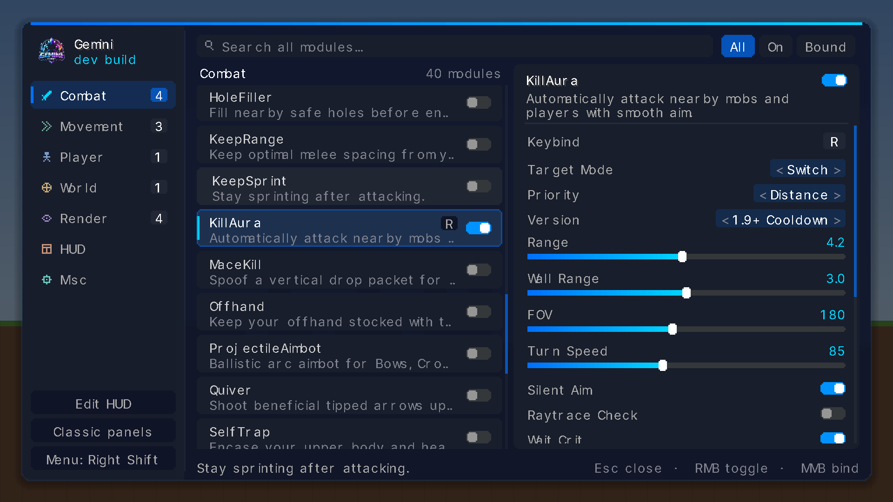

<div align="center">
  

  # Gemini Client

  **A single-player utility / sandbox client for Minecraft 26.3 (Fabric).**

  279 modules · window or panel ClickGUI · draggable HUD · pathfinding bot (Baritone built in)

  [](https://www.minecraft.net/)
  [](https://fabricmc.net/)
  [](https://github.com/mooreconnell24-gif/gemini-client/releases)
  [](https://adoptium.net/)
  [](LICENSE)

  [Install](#installation) · [Controls](#controls) · [Commands](#commands) · [What's new](#whats-new-in-320) · [Build](#building-from-source) · [Issues](https://github.com/mooreconnell24-gif/gemini-client/issues)
</div>

---

## Overview

Gemini is a client-side Fabric mod for playing around in your own single-player worlds: flight, X-ray, ESP, auto-farming, building helpers, game-rule switches, a pathfinding bot and a fully draggable HUD.

**Gemini is single-player only.** Its modules, HUD, commands and bot run in your own private worlds and nowhere else; they pause whenever a world is opened to LAN, and they never run while you are connected to a server.

That is controlled by one switch, **sandbox mode** (on by default):

| Sandbox mode | Gemini | Servers and Realms |
|---|---|---|
| **On** | Active in single-player worlds | Refused, with a screen that says why and offers to switch Gemini off |
| **Off** | Switched off completely: no modules, HUD, commands or bot | Allowed, like an unmodded client |

Flip it with the button in the top-left corner of the title screen, with `.sandbox on` / `.sandbox off`, or from the screen shown when a connection is refused. There is no setting that runs modules on a server.

Everything runs locally. There is no account system, API key, cloud service or telemetry.

> **Note:** This project was generated by AI as a capability test of modern development workflows. It is a proof of concept for end-to-end AI-assisted building (codebase, build system, GUI and mod logic).

<div align="center">
  
  <br><sub>Window layout (rendered offline; in game the text uses the Minecraft font)</sub>
</div>

## What's new in 3.2.0

**Sandbox mode instead of "remove the jar".** The multiplayer lock is now a switch. With it on, Gemini works as before and a refused connection gets a screen that explains why. With it off, Gemini is completely dormant and you can play online without uninstalling it. Modules still never run on a server.

**Safer saves.** The config is written on a background thread to a temporary file, forced to disk and renamed into place, so a crash or power cut can never leave half a file. The previous version is kept as `gemini_config.json.bak` and is restored automatically if the config cannot be read. A save that fails is retried and reported instead of being lost.

**Shareable profiles.** `.config export <name>` writes your settings to `config/gemini_exports/` (or `.config export <name> clipboard` copies them). Exports leave out waypoints, your home, death coordinates and menu layout. `.config import <name> [clipboard]` stores one as a profile.

**Faster built-in pathfinder.** The fallback A* was rebuilt around reused primitive arrays and a chunk cache: a search no longer allocates per node, reads blocks several times faster, and uses a tighter heuristic. Unloaded chunks are treated as walls and waited for instead of being bridged into, paths are kept while they are still walkable instead of being recomputed every 1.6 seconds, and a pause for combat or an open screen no longer looks like "stuck".

**One bot at a time.** Baritone and the built-in engine can no longer steer you at once: a request to one stops the other.

**Lighter rendering.** ESP boxes behind you are skipped before any work is done, an outlined and filled box is drawn as one shape instead of two, HoleESP and Trajectories do their world queries once a tick instead of once a frame, and a frame has a shape budget so a huge block list cannot freeze the game.

**Fixes you might notice**

- Modules that send packets from their tick could lose their place in the priority order for the rest of that tick, letting a lower-priority module take the hotbar slot or rotation from them.
- Xray could keep showing ore positions from before it was switched off or reconfigured, and from the previous dimension after a portal.
- Combat and render modules kept targets and markers from the previous dimension after going through a portal.
- The ClickGUI **Blur** switch did nothing.

**Merged**

| Was | Now |
|---|---|
| ReverseStep | **Fast Fall** › *When*: `Ledges` (its Height and Speed are now *Ledge Height* and *Ledge Speed*; `Both` runs the two together). Your settings, switch and key bind are carried over, and `.reversestep` still finds it |

<details>
<summary>What was new in 3.1.0</summary>

**New modules**

| Module | What it does |
|---|---|
| Buffs | Permanent potion effects on switches: god mode, speed, haste, night vision and more |
| Enchanter | Maxes out the held item or your armour with the best vanilla enchantments |
| Give List | Gives you your own list of items in one click |
| Platform | Puts a platform under your feet, or removes it |
| Locate | Finds the nearest structure or biome, pins it and optionally teleports there |
| Auto Save | Saves the world every few minutes |
| Performance | FPS mode: low render distance, no clouds, shadows or particles, restored when switched off |
| Cinematic Camera | Smooth camera movement for recording |

**Menu.** Eight more themes, a *Surface* setting for the panel colour (Dark, OLED, Slate, Graphite, Plum), *Category Tint*, and **favourites**: star a module on its card and filter by ★.

**Also.** Death Coords can pin a waypoint and teleport back, World Rules sets the difficulty, Home can set your spawn point, and `.version` reports any Minecraft hook that failed to apply.

</details>

<details>
<summary>What was new in 3.0.0</summary>

**Baritone built in.** The jar bundles a [Baritone](https://github.com/cabaletta/baritone) build for Minecraft 26.3, so every bot module and `#` command (`#goto`, `#mine`, `#follow`, `#tunnel`, `#farm`, `#explore`, `#excavate`) runs on it with no extra download. If Baritone fails to load, Gemini falls back to its built-in pathfinder.

**Built-in pathfinder rebuilt.** The fallback engine now prices mining by what your best hotbar tool needs, adds the cost of sand or gravel, and correctly handles drop jumps and lava.

**Block breaking fixed.** Vanilla aborts a block in progress every tick the attack key is held, so Nuker, VeinMiner, Fucker, PacketMine and the bot's own mining could only ever break instant blocks.

**Modules never fight over your hands.** Every module runs at an `ActionPriority` (survival > combat > movement > world utility > bot).

**One file per module, one event bus.** The module containers were split into `gemini/module/modules/<category>/<Module>.java` with no change to config keys.

**Smoother menus.** Searching in either menu is fuzzy and covers names, aliases, descriptions and setting names.

**New modules**

| Module | What it does |
|---|---|
| Auto Heal | `/effect` heal (instant health, regeneration or full heal, plus saturation) when your health drops below a threshold |
| Kits | PvP, Crystal, Builder, Miner, Explorer or Food loadouts with `/give` and `/item`, armour equipped straight away |
| Mob Sweeper | Clears hostile mobs, all mobs or dropped items around you with `/kill` on an interval |
| Summoner | Summons a chosen mob (or lightning) a few blocks in front of you, bindable |
| Aim | Spring smoothing and the silent-aim marker for every rotating module |

Configs from 2.x are upgraded automatically.

</details>

<details>
<summary>What was new in 2.2.0</summary>

**New window menu.** One centred window with a category sidebar, a module list that searches every category, and a settings pane for the selected module.

**New modules**

| Module | What it does |
|---|---|
| World Rules | Switches for Keep Inventory, Daylight/Weather Cycle, Mob Spawning, Mob Griefing, Fire Spread, Phantoms, Fall Damage, Instant Respawn, plus a Random Tick Speed slider |
| Tick Freeze | Freezes mobs, redstone and time while you keep moving; Step advances it |
| Macro 1–3 | Bind a key to a list of `/commands`, `.gemini` commands or chat lines |
| Inventory Sorter | Sorts and merges your inventory by item or stack size |
| Durability Alert | Warns once before armour or a held tool breaks |
| Waypoints (upgraded) | 3D beacons and labels, pins kept per world, `.waypoints add/remove/list/tp/clear` |

**Bug fixes.** These are the ones you would have noticed:

- **AutoFish** reeled the bobber back in right after casting.
- **NoFall** no longer hurts at high speed.
- **Silent aim** works correctly for item use.
- **AutoSoup** works with modern eating times.
- **NoWeb** really lets you walk through webs and similar blocks.
- **Criticals** default modes now work as expected.
- **SmartEat** no longer misbehaves with golden apples.
- **InventoryMove** uses vanilla movement rules.
- Sliders no longer show drifting decimal values.
- The config is no longer rewritten on every slider or HUD drag.

The rest:

- AntiVoid has a Teleport mode.
- Zoom and Free Look binds default to Hold.
- PacketLogger hides per-tick packets.
- Smaller fixes landed in AirJump, AutoGapple, AutoWalk, AutoBlock, KillAura, Nuker, Slime Chunks and Presets.

</details>

## Highlights

| | |
|---|---|
| **279 modules** | Combat, Movement, Player, World, Render, HUD and Misc |
| **Two menu layouts** | Window (fuzzy-search everything, settings side by side) or classic panels |
| **HUD widgets** | FPS, TPS, armour, potions, radar, TargetHUD, keystrokes, graphs and more; drag them anywhere with magnetic snapping |
| **Pathfinding bot** | Drives the bundled Baritone; built-in 3D A* fallback with `#goto`, `#mine`, `#follow`, `#tunnel`, `#farm`, `#explore`, `#excavate` |
| **Priority arbitration** | Modules claim hands and rotations in priority order, so survival modules always win |
| **Profiles** | Crash-safe autosave with a backup, named profiles, and export/import for sharing |
| **Crash isolation** | A failing module is switched off and reported instead of taking the game down |

## Module overview

| Category | Examples |
|---|---|
| Combat | KillAura, AutoCrystal, AnchorAura, Criticals, Velocity, AutoTotem, TriggerBot, ProjectileAimbot |
| Movement | Flight, Speed, Step, Jesus, Elytra Fly, NoFall, NoWeb, Spider, Boat Fly, Click TP |
| Player | Clutch, AutoArmor, AutoEat, AutoTool, AutoFish, Auto Heal, Kits, Inventory Sorter, Durability Alert, Reach, FastBreak |
| World | Scaffold, Nuker, Auto Farm, Vein Miner, World Rules, Tick Freeze, Mob Sweeper, Summoner, Time, Weather, Waypoints |
| Render | ESP, StorageESP, Xray, Tracers, Nametags, Freecam, Zoom, Fullbright, Search |
| HUD | FPS, CPS, Armor, Potion Timers, Radar, TargetHUD, Keystrokes, Inventory Viewer |
| Misc | ClickGUI, HUD, Macro 1–3, Panic, Presets, NameProtect, Better Chat |

### Clutch

Clutch (Player) watches for whatever is about to kill you and answers it with the best item in your hotbar or offhand.

| Danger | What Clutch does |
|---|---|
| Lethal fall | Predicts the fall damage for the block you will land on and MLGs with a water bucket, cobweb, twisting vines, powder snow, slime, scaffolding or (when survivable) hay. **Brake** slows a very fast fall just enough to fit the MLG into reach, and **Scoop** picks the water back up |
| Lava | Water or a block onto lava you are falling into, water and a swim out if you are in it, and **Lava Guard** stops you walking or stepping off into it |
| Fire | Drops water at your feet once health is low enough to matter |
| Void, drowning, suffocation | Swims up for air; with Last Resort, teleports you back to the last safe spot or gives water breathing |
| Low health | Moves a totem into your offhand |

**Last Resort** (single-player) steps in when no item can help: it resets fall damage just before you land, gives fire resistance, water breathing or healing, or teleports you to the last safe ground. **Danger / Fall / Lava / Health Modules** are lists of other modules Clutch switches on during that danger (Lava defaults to Jesus, Health to AutoTotem); **Restore Modules** turns them back off once you have been safe for **Restore Delay** ticks. Edit them in the menu or with `.set Clutch Lava_Modules add <module>`.

## Installation

### Requirements

| Requirement | Version |
|---|---|
| Minecraft Java Edition | **26.3** |
| Fabric Loader | 0.19.5 or newer |
| Fabric API | Built for 26.3 (developed against `0.165.2+26.3`) |
| Java | 25 or newer |

### Steps

1. Install **Fabric Loader** for Minecraft 26.3.
2. Put the matching **Fabric API** jar into your `mods` folder.
3. Download the `gemini-<version>.jar` in the root of this repo (or build it, see below) and put it in `mods`.
4. Baritone is already bundled inside the jar. Do not add a separate Baritone jar to `mods`.
5. Start the game with the Fabric profile and open a single-player world.
6. Press **Right Shift** to open the menu.

## Controls

**Window layout (default)**

| Input | Action |
|---|---|
| **Right Shift** | Open / close the menu (rebind it from the sidebar or in Controls) |
| **Click a module** | Show its settings |
| **Click the switch** / **right-click** a module | Toggle it |
| **Middle-click a module** | Bind a key (`Delete` clears, `Esc` cancels) |
| **Type anything** | Search every module; `Esc` clears and keeps your selection |
| **↑ ↓**, **Enter**, **Tab** | Move the selection, toggle it, switch category |
| **Right-click a setting** | Reset it to the default |

**Classic panels**

| Input | Action |
|---|---|
| **Left click** | Toggle a module |
| **Right click** | Open module settings |
| **Middle click** | Bind a key |
| **Shift + drag** | Move HUD widgets |
| **Ctrl + F** | Search |

## Commands

Chat commands use a `.` prefix. Module names are case-insensitive.

| Command | Description |
|---|---|
| `.help` | Command list |
| `.gui` | Open the menu |
| `.toggle <module> [on\|off]` or `.<module>` | Toggle a module |
| `.set <module> <setting> <value>` / `.get <module> [setting]` | Change or inspect a setting (`_` for spaces) |
| `.bind <module> <key>` / `.unbind <module>` / `.binds` | Key binds (`.binds` flags keys used twice) |
| `.modules [category]` | List modules |
| `.config save\|load\|delete\|list\|reset <name>` / `.reload` | Profiles and the config file |
| `.config export <name> [clipboard]` / `.config import <name> [clipboard]` | Share a profile as a file in `config/gemini_exports/` or as text |
| `.sandbox [on\|off]` | Sandbox mode: on keeps Gemini active and offline, off switches Gemini off for online play |
| `.waypoints add [name]\|remove <name>\|list\|tp <name>\|clear` | Waypoints in this world |
| `.sethome` / `.home` / `.back` | A saved teleport in this world |
| `.gm <mode>` / `.day` / `.night` / `.sun` / `.rain` / `.heal` / `.feed` | World and player shortcuts |
| `.vclip <blocks>` / `.hclip <blocks>` / `.coords` | Movement and position helpers |
| `.panic` | Turn every module off |
| `.version` | Gemini and Minecraft versions |
| `.selftest` | Crash-test every module in a throwaway world |

Pathfinding commands use `#` (`.b` also works):

| Command | Description |
|---|---|
| `#goto <x> [y] <z>` | Pathfind to coordinates |
| `#mine <block> [block...]` | Find and mine blocks, e.g. `#mine diamond_ore` |
| `#follow [player\|players\|mobs]` | Follow a player or mobs |
| `#tunnel [length]` / `#excavate [radius] [depth]` | Dig a tunnel or clear an area |
| `#farm` / `#explore` | Harvest crops / spiral into new chunks |
| `#sel pos1\|pos2\|clear` / `#thisway <distance>` / `#axis` | Selections and goals |
| `#pause` / `#resume` / `#stop` / `#status` | Control the current task; `#status` names the engine in use |

Any other Baritone command (`#set`, `#build`, `#schematica`, `#find`, ...) is passed straight through to it.

## Configuration

| Path | Contents |
|---|---|
| `config/gemini_config.json` | Modules, settings, key binds, HUD layout, panels and the `sandboxMode` switch |
| `config/gemini_config.json.bak` | The previous good save |
| `config/gemini_profiles/` | Named profiles from `.config save <name>` |
| `config/gemini_exports/` | Portable profiles from `.config export <name>`; drop a received file here and run `.config import <name>` |

Changes are saved a moment after you stop editing, and always on exit. Saves are atomic: the file on disk is always a complete one. If the config cannot be read, Gemini restores the backup and tells you; only if that is unreadable too does it start from defaults. Either way the unreadable file is kept as `gemini_config.json.broken`.

## Building from source

Requirements: JDK **25**, Git, and internet access for the first Gradle run.

```bash
git clone https://github.com/mooreconnell24-gif/gemini-client.git
cd gemini-client
./gradlew build
```

On Windows use `gradlew.bat build`. The jar lands in `build/libs/gemini-<version>.jar`. `build` also runs the unit tests (`./gradlew test` runs just those). Run a development client with `./gradlew runClient`.

## Project layout

```text
src/main/java/gemini/
├── Gemini.java              Client entrypoint
├── command/                 Chat command system
├── config/                  Config, atomic JSON files, migrations, profiles and profile bundles
├── diags/                   Report of Minecraft hooks that failed to apply
├── event/                   Priority event bus, @EventHandler, ActionPriority
├── input/                   Key mappings and keybind conflict checks
├── mixin/                   Fabric mixins; mixin/lock refuses server connections while sandbox mode is on
├── module/                  Module framework, settings, categories, shared bases (placement, aura, linear flight)
│   └── modules/<category>/  One file per module
├── render/                  3D rendering helpers
├── ui/                      Menus (window + classic panels), HUD overlay, fuzzy search
├── util/                    Baritone bridge + built-in pathfinder, rotations, hands arbiter, single-player gate
│   └── pathing/             The A* search core and the chunk-cached block view
src/test/java/gemini/        Unit tests for the search, the event bus and config handling
└── xray/                    Xray data and compilation
```

## Troubleshooting

| Problem | Fix |
|---|---|
| Crash on launch | Check Minecraft 26.3, a matching Fabric Loader and Fabric API, and Java 25; see `logs/latest.log` |
| "Gemini sandbox mode is on" when joining a server | Expected: Gemini is single-player only. Choose **Switch Gemini off** on that screen (or `.sandbox off`) to play online; switch it back on from the title screen |
| Nothing works in single-player | Sandbox mode is off, so Gemini is dormant: click the title screen button or type `.sandbox on` |
| Modules will not turn on | Open a single-player world; modules pause while the world is open to LAN |
| Menu will not open | Check Options › Controls › Gemini Client › Open Gemini |
| A module switched itself off | It crashed and was isolated; the chat message and `logs/latest.log` have details |
| Settings reset | Gemini restores `gemini_config.json.bak` by itself when the config is damaged; otherwise `.config load <name>`, or look at `gemini_config.json.broken` |

## Disclaimer

Gemini Client is a client-side mod for single-player worlds. With sandbox mode on it refuses server and Realms connections; with it off it does nothing at all. The authors are not responsible for lost items, worlds or other consequences.

Gemini Client is not affiliated with Mojang, Microsoft, Fabric, LiquidBounce or Baritone.

## Credits

- **Fabric** for the mod loader and API
- **LiquidBounce Nextgen**, **Rise** and **Meteor** for UI and feature inspiration
- **Baritone** for pathfinding, bundled in the release jar
- Testers and issue reporters

## License

Released under the [MIT License](LICENSE).

The jar bundles Baritone, licensed under the [LGPL-3.0](https://github.com/cabaletta/baritone/blob/master/LICENSE). The bundled build is an unofficial Minecraft 26.3 port by dysnasia ([source](https://github.com/dysnasia/baritone-26.2)) of [cabaletta/baritone](https://github.com/cabaletta/baritone), and includes [nether-pathfinder](https://github.com/babbaj/nether-pathfinder) 1.4.1.

Copyright © 2026 Gemini Client.
